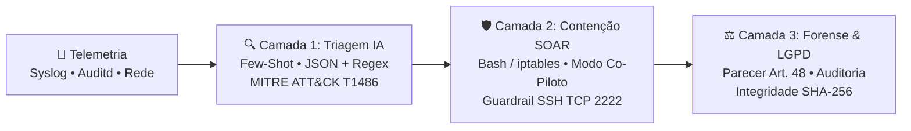
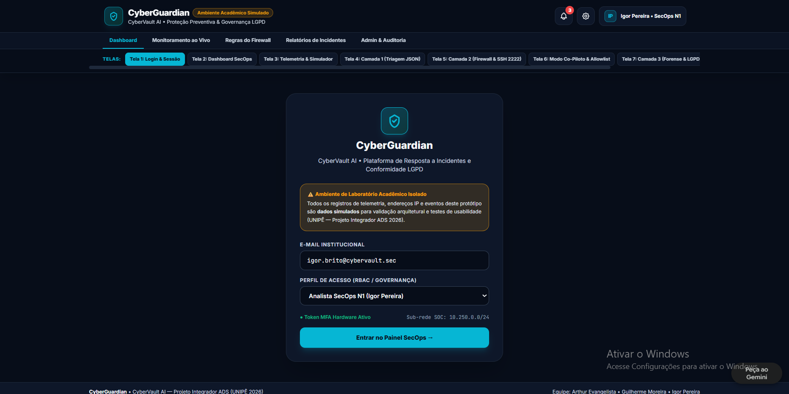
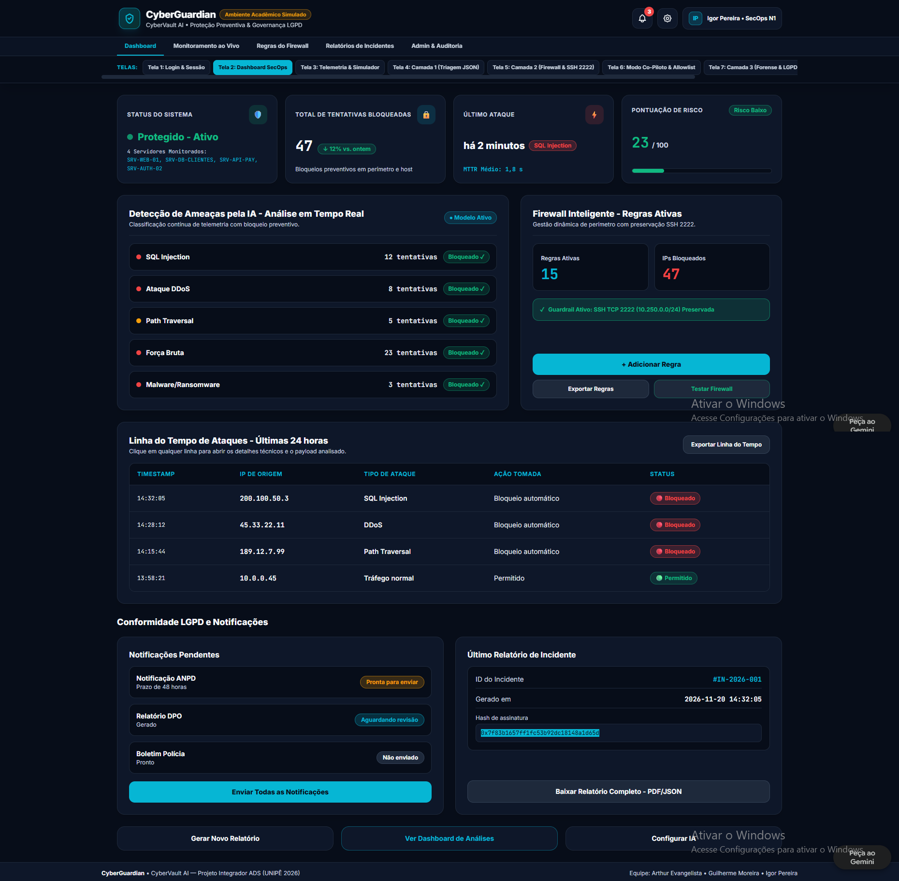
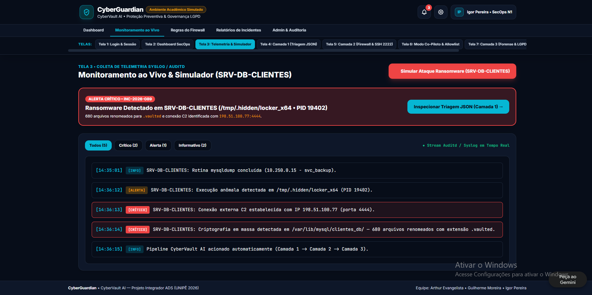
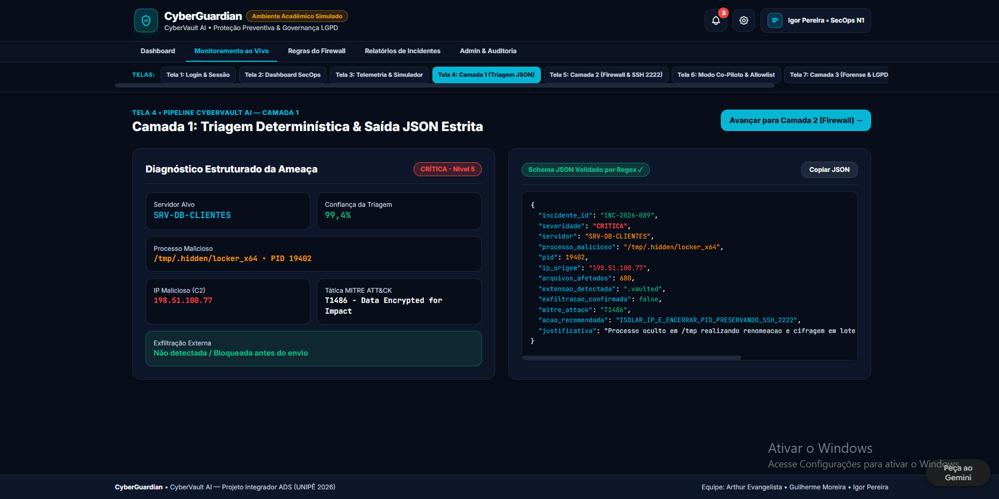
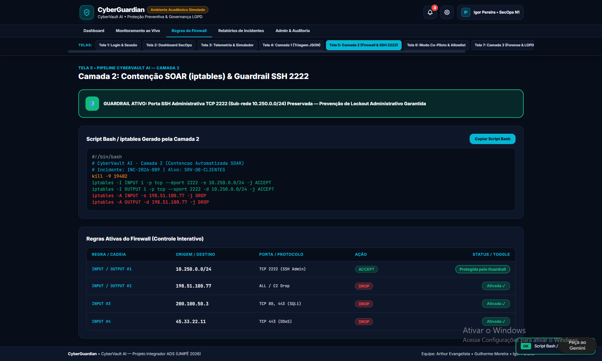
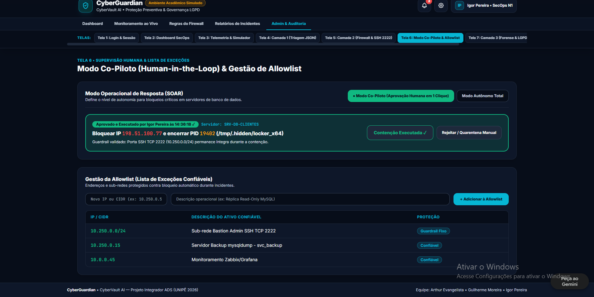
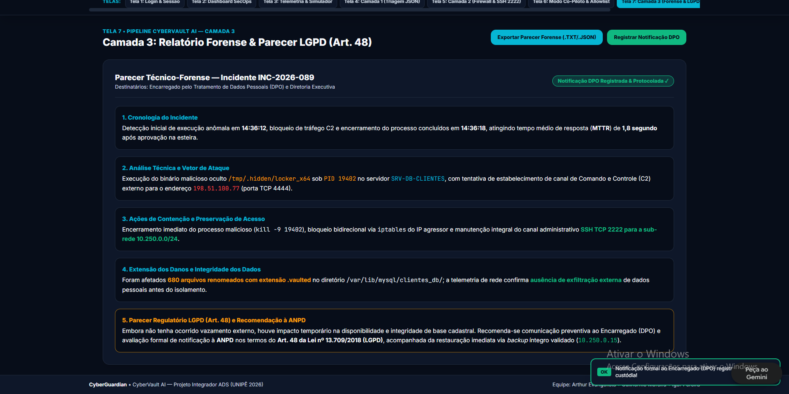
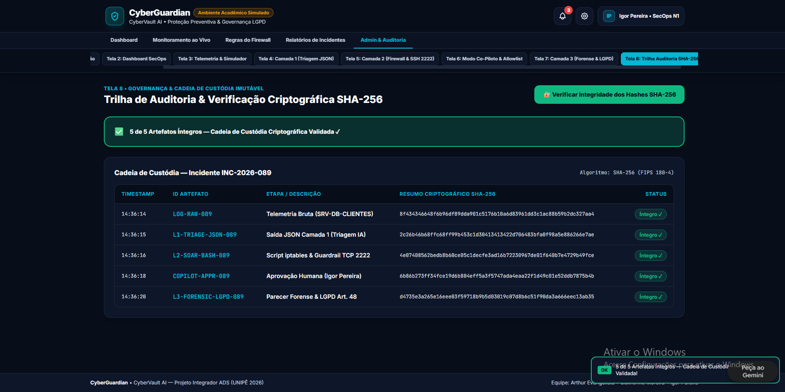

<div align="center">

# 🛡️ CyberVault AI (Cyber Guardian)

**Plataforma Inteligente de Apoio às Operações de Cibersegurança (SecOps), Contenção SOAR com Salvaguardas e Conformidade LGPD**

[](https://igorpereira59.github.io/CyberVault-AI/)
[](#3-arquitetura-conceitual-em-três-camadas)
[-1D4E89?style=for-the-badge)](#5-validação-experimental-e-pesquisa-de-mercado)

[Acessar Aplicação Web](https://igorpereira59.github.io/CyberVault-AI/) • [Arquitetura](#3-arquitetura-conceitual-em-três-camadas) • [Telas do Sistema](#4-demonstração-das-8-telas-do-protótipo) • [Validação](#5-validação-experimental-e-pesquisa-de-mercado) • [Equipe](#6-equipe-e-contexto-acadêmico)

</div>

---

## 1. Visão Geral

O **CyberVault AI** — identificado na interface como **Cyber Guardian** — é um protótipo funcional de apoio à resposta a incidentes cibernéticos e governança de dados, desenvolvido no âmbito do **Projeto Integrador de Análise e Desenvolvimento de Sistemas (UNIPÊ — Turma ADS - F)**.

O projeto endereça o impacto operacional e social de ataques de **Ransomware e Vazamento de Dados** (tema priorizado com **22/25 pontos** em matriz multicritério), oferecendo uma camada inteligente de triagem e contenção inicial para ambientes que não contam com equipes SOC 24×7 ou plataformas SIEM/SOAR corporativas de alto custo.

> **Aviso de Escopo Acadêmico:** Este repositório contém um protótipo web navegável com telemetria simulada (`INC-2026-089` / servidor `SRV-DB-CLIENTES`) para validação arquitetural e testes de usabilidade.

---

## 2. Salvaguardas Éticas, Técnicas e Legais (Guardrails)

A arquitetura incorpora controles rigorosos inspirados em incidentes reais (*WannaCry*, 2017; falha `redis-py` no *ChatGPT*, 2023) e na **Lei Geral de Proteção de Dados (Lei nº 13.709/2018)**:

* **Proteção contra *Prompt Injection*:** Logs externos são delimitados como dado não confiável e toda saída da IA passa por validação determinística (**JSON Schema + Regex**) antes de qualquer recomendação.
* **Prevenção de *Lockout* Administrativo:** Regras negativas proíbem desligar interfaces de rede e preservam obrigatoriamente o acesso administrativo via **SSH TCP 2222** para a sub-rede SOC (`10.250.0.0/24`).
* **Supervisão Humana (*Modo Co-Piloto*):** Bloqueios de IP e encerramento de processos exigem aprovação explícita do analista em 1 clique e respeitam uma **Allowlist** de ativos críticos (como servidores de backup).
* **Limite Jurídico (LGPD Art. 48):** A IA estrutura o diagnóstico técnico e o checklist regulatório, mas a decisão de notificar a **ANPD** e os titulares permanece exclusivamente humana.

---

## 3. Arquitetura Conceitual em Três Camadas



| Camada | Responsabilidade Principal | Entregas Técnicas |
| :--- | :--- | :--- |
| **Camada 1 (L1)** | Triagem Determinística & Classificação | Classificação em `CRITICAL`, `ALERT` ou `COMPLIANCE` com extração validada de servidor, `PID`, IP de origem e tática `MITRE ATT&CK`. |
| **Camada 2 (L2)** | Contenção SOAR Segura | Geração de script `Bash`/`iptables` para isolamento lógico em laboratório com preservação garantida da porta `SSH TCP 2222`. |
| **Camada 3 (L3)** | Consolidação Forense & LGPD | Relatório cronológico completo, avaliação de exfiltração, checklist do Art. 48 da LGPD e cadeia de custódia com hash `SHA-256`. |

---

## 4. Demonstração das 8 Telas do Protótipo

O cenário simulado (`INC-2026-089`) reproduz a detecção do binário malicioso `/tmp/.hidden/locker_x64` (`PID 19402`) no servidor **`SRV-DB-CLIENTES`**, comunicando-se com o endereço C2 `198.51.100.77:4444` após renomear `680` arquivos para `.vaulted`.

| Tela | Módulo / Camada | Descrição Funcional | Captura de Tela |
| :---: | :--- | :--- | :---: |
| **01** | **Login & Sessão RBAC** | Autenticação institucional, perfil SecOps N1, token MFA e aviso de ambiente simulado. |  |
| **02** | **Dashboard SecOps** | Painel executivo com status *Protegido - Ativo*, `47` bloqueios preventivos e MTTR de `1,8s`. |  |
| **03** | **Telemetria & Simulador** | Fluxo *Auditd/Syslog* em tempo real com gatilho interativo de ataque Ransomware. |  |
| **04** | **Camada 1 — Triagem JSON** | Diagnóstico estruturado (`CRITICAL`, `99,4%` confiança, `MITRE T1486`) e payload JSON. |  |
| **05** | **Camada 2 — Firewall SOAR** | Script `Bash`/`iptables` (`kill -9 19402` + `DROP C2`) e proteção ativa `SSH TCP 2222`. |  |
| **06** | **Modo Co-Piloto & Allowlist** | Aprovação humana em 1 clique (*Human-in-the-Loop*) e gestão de exceções confiáveis. |  |
| **07** | **Camada 3 — Parecer LGPD** | Parecer técnico-forense em 5 seções confirmando ausência de exfiltração e orientação Art. 48. |  |
| **08** | **Trilha Auditoria SHA-256** | Cadeia de custódia verificando a integridade criptográfica de `5/5` artefatos gerados. |  |

---

## 5. Validação Experimental e Pesquisa de Mercado

### Levantamento de Mercado ($N = 15$ Vagas Reais no LinkedIn)
* **Recorte da Amostra:** `66,7%` Dados & DBA (`10` vagas) e `33,3%` Cibersegurança & Infraestrutura (`5` vagas).
* **Competências Mais Exigidas:** Monitoramento & Logs (`93,3%`), Resposta a Incidentes & Troubleshooting (`80,0%`), SQL & SGBDs (`66,7%`) e Segurança, Governança & LGPD (`60,0%`).

### Testes de Usabilidade ($N = 6$ Voluntários Externos Anonimizados `P1`–`P6`)
* **Taxa de Sucesso Operacional:** **`100,0%` (`36/36` tarefas concluídas)** sem erros ou bloqueios.
* **Aprovação Visual e Guiada:** **`100,0%` (`6/6` participantes)** aprovaram a organização visual e a condução passo a passo.
* **Acessibilidade entre Perfis:** `83,3%` (`5/6`) navegaram sem barreiras; `16,7%` (`1/6`, perfil sem experiência prévia) concluiu integralmente o roteiro com apoio da sequência guiada.

---

## 6. Estrutura do Repositório

```text
CyberVault-AI/
├── index.html                                    # Aplicação web interativa (8 telas integradas)
├── README.md                                     # Documentação técnica do projeto
├── Tela_01_Login_e_Sessao.png                    # Captura — Tela 1
├── Tela_02_Dashboard_SecOps_Completa.png         # Captura — Tela 2
├── Tela_03_Telemetria_e_Simulador.png            # Captura — Tela 3
├── Tela_04_Camada1_Triagem_JSON.png              # Captura — Tela 4
├── Tela_05_Camada2_Firewall_SSH2222_Completa.png # Captura — Tela 5
├── Tela_06_Modo_CoPiloto_e_Allowlist.png         # Captura — Tela 6
├── Tela_07_Camada3_Forense_e_LGPD.png            # Captura — Tela 7
└── Tela_08_Trilha_Auditoria_SHA256.png           # Captura — Tela 8
```

---

## 7. Equipe e Contexto Acadêmico

* **Instituição:** Centro Universitário de João Pessoa (UNIPÊ) — Curso de Análise e Desenvolvimento de Sistemas (**ADS - F**)
* **Docente Orientadora:** Prof.ª Karine Heloise Felix De Sousa
* **Ano:** 2026

| Integrante | Papel no Projeto |
| :--- | :--- |
| **Arthur Evangelista Sousa de Lucena** | Pesquisa de Mercado, Matriz de Priorização, Estruturação de Dados e Conformidade |
| **Igor Pereira Canindé de Brito** | Arquitetura em 3 Camadas, Engenharia de Prompts, Guardrails SecOps e Protótipo Web |
| **Guilherme Moreira Torres da Costa** | Consolidação de Fluxos de Dados, Protocolo de Testes de Usabilidade e Análise Experimental |
